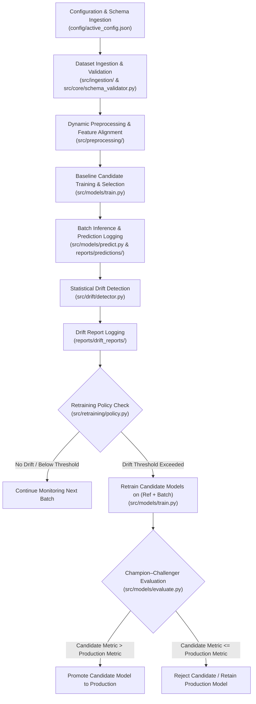
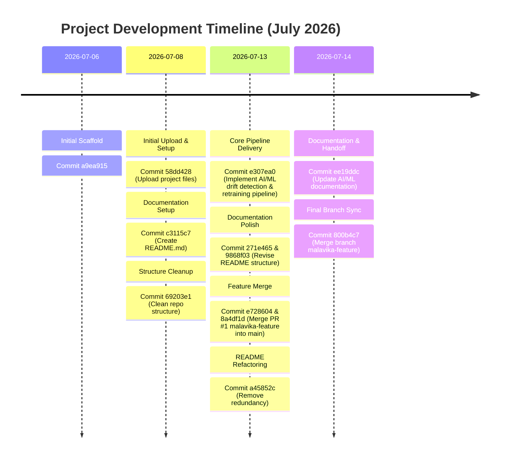

# Project Summary & Handoff Report

**Project Name:** Automated ML Drift Detection and Retraining Pipeline  
**Repository:** `Malavikavinod7/ml-drift-detection-retraining-pipeline`  
**Workspace Location:** [`ML-Drift-Detection-and-Retraining-Pipeline`](file:///c:/Users/DELL/OneDrive/Desktop/ML-Drift-Detection-and-Retraining-Pipeline)  
**Report Date:** August 18, 2026  

---

## 1. Executive Summary

This project is an end-to-end Machine Learning monitoring and automated retraining platform designed for tabular classification applications. It continuously monitors production incoming batch data for distribution shifts (**data drift**), evaluates model performance degradation, and automatically retrains and promotes superior candidate models using a **Champion–Challenger strategy**. Built for ML engineers, data engineers, and MLOps practitioners, the project serves as a production-style demonstration of automated model lifecycle management. Its current status is a **functional prototype / completed proof-of-concept**, fully operational via a command-line interface with schema-driven configuration, automated CSV logging, and synthetic drift simulation.

---

## 2. Objectives & Scope

### Original Objectives
- **Continuous Drift Monitoring:** Automatically compare incoming batch features against baseline reference data using statistical tests.
- **Automated Retraining Decisions:** Trigger retraining dynamically when the percentage of drifted features crosses a preconfigured threshold.
- **Multi-Model Candidate Training:** Evaluate multiple candidate algorithms (Random Forest, Logistic Regression, Decision Tree) on every retraining cycle.
- **Automatic Model Selection:** Select candidate models based on primary evaluation metrics (validation F1-Score).
- **Champion–Challenger Model Promotion:** Promote candidate models to production only if they outperform the current production model.
- **Schema-Driven Architecture:** Maintain a modular, configuration-driven data and ML pipeline capable of supporting multiple business use cases without source code modifications.

### Delivered Scope
- **Complete Orchestration Pipeline:** Executable entry point [`src/main.py`](file:///c:/Users/DELL/OneDrive/Desktop/ML-Drift-Detection-and-Retraining-Pipeline/drift-retrain-platform/src/main.py) coordinating configuration loading, ingestion, preprocessing, predictions, drift detection, policy checks, retraining, evaluation, and promotion.
- **Multi-Use Case Support:** Configurations and schemas for two distinct business applications:
  1. `customer_churn`: Customer churn prediction for telecom users.
  2. `credit_risk`: Loan default prediction for credit applicants.
- **Dynamic Preprocessing & Alignment Engine:** [`DynamicPreprocessor`](file:///c:/Users/DELL/OneDrive/Desktop/ML-Drift-Detection-and-Retraining-Pipeline/drift-retrain-platform/src/preprocessing/preprocessor.py) for imputing, scaling, and one-hot encoding tabular features, paired with [`align_features`](file:///c:/Users/DELL/OneDrive/Desktop/ML-Drift-Detection-and-Retraining-Pipeline/drift-retrain-platform/src/preprocessing/feature_alignment.py) for batch column ordering.
- **Statistical Drift Engine:** [`compute_drift_report`](file:///c:/Users/DELL/OneDrive/Desktop/ML-Drift-Detection-and-Retraining-Pipeline/drift-retrain-platform/src/drift/detector.py) calculating Kolmogorov–Smirnov (KS) test statistics, p-values, and severity ranks.
- **Synthetic Data & Drift Generators:** Realistic data generators ([`generate_synthetic_customer_churn.py`](file:///c:/Users/DELL/OneDrive/Desktop/ML-Drift-Detection-and-Retraining-Pipeline/drift-retrain-platform/scripts/generate_synthetic_customer_churn.py) and [`generate_synthetic_credit_risk.py`](file:///c:/Users/DELL/OneDrive/Desktop/ML-Drift-Detection-and-Retraining-Pipeline/drift-retrain-platform/scripts/generate_synthetic_credit_risk.py)) capable of injecting controlled drift levels (0.0 to 0.90) and missing values.
- **Structured Audit Logging:** Automated generation of CSV logs for batch predictions, feature drift reports, and model evaluation metrics under `reports/`.

---

## 3. Tech Stack

### Programming Languages & Environments
- **Primary Language:** Python 3.11.9 (System fallback: Python 3.12.10)
- **Environment:** Virtual environment located at [`drift-retrain-platform/.venv`](file:///c:/Users/DELL/OneDrive/Desktop/ML-Drift-Detection-and-Retraining-Pipeline/drift-retrain-platform/.venv)

### Core Libraries & Dependencies

| Library | Installed Version | Purpose |
| :--- | :--- | :--- |
| [`numpy`](file:///c:/Users/DELL/OneDrive/Desktop/ML-Drift-Detection-and-Retraining-Pipeline/drift-retrain-platform/requirements.txt#L1) | `2.4.6` | Numerical operations, array manipulation, synthetic distribution generation |
| [`pandas`](file:///c:/Users/DELL/OneDrive/Desktop/ML-Drift-Detection-and-Retraining-Pipeline/drift-retrain-platform/requirements.txt#L2) | `3.0.3` | Tabular data manipulation, batch loading, metadata framing, log formatting |
| [`scikit-learn`](file:///c:/Users/DELL/OneDrive/Desktop/ML-Drift-Detection-and-Retraining-Pipeline/drift-retrain-platform/requirements.txt#L3) | `1.9.0` | `ColumnTransformer`, `Pipeline`, `StandardScaler`, `OneHotEncoder`, `SimpleImputer`, `RandomForestClassifier`, `LogisticRegression`, `DecisionTreeClassifier`, evaluation metrics |
| `scipy` | `1.17.1` | Statistical hypothesis testing (`ks_2samp`, `chi2_contingency`) |
| `joblib` | `1.5.3` | Internal scikit-learn dependency |
| `python-dateutil` | `2.9.0.post0` | Date and time parsing for logs |

### Formats & Tools
- **Configuration:** JSON schemas and JSON configurations
- **Data Storage:** Flat CSV files
- **Version Control:** Git & GitHub (`Malavikavinod7/ml-drift-detection-retraining-pipeline`)

---

## 4. Architecture Overview

### High-Level System Workflow



### Key Modules and File References

- **Configuration Layer ([`config/`](file:///c:/Users/DELL/OneDrive/Desktop/ML-Drift-Detection-and-Retraining-Pipeline/drift-retrain-platform/config)):**
  - [`active_config.json`](file:///c:/Users/DELL/OneDrive/Desktop/ML-Drift-Detection-and-Retraining-Pipeline/drift-retrain-platform/config/active_config.json): Specifies active use case (`"customer_churn"` or `"credit_risk"`).
  - Use case directories ([`credit_risk/`](file:///c:/Users/DELL/OneDrive/Desktop/ML-Drift-Detection-and-Retraining-Pipeline/drift-retrain-platform/config/use_cases/credit_risk), [`customer_churn/`](file:///c:/Users/DELL/OneDrive/Desktop/ML-Drift-Detection-and-Retraining-Pipeline/drift-retrain-platform/config/use_cases/customer_churn)): Contain `schema.json`, `pipeline_config.json`, `model_config.json`.
- **Core Orchestration & Metadata ([`src/core/`](file:///c:/Users/DELL/OneDrive/Desktop/ML-Drift-Detection-and-Retraining-Pipeline/drift-retrain-platform/src/core)):**
  - [`config_loader.py`](file:///c:/Users/DELL/OneDrive/Desktop/ML-Drift-Detection-and-Retraining-Pipeline/drift-retrain-platform/src/core/config_loader.py): Reads active use case and loads active schema/config JSONs.
  - [`metadata_builder.py`](file:///c:/Users/DELL/OneDrive/Desktop/ML-Drift-Detection-and-Retraining-Pipeline/drift-retrain-platform/src/core/metadata_builder.py): Merges schemas and configs into a unified pipeline metadata dictionary.
  - [`schema_validator.py`](file:///c:/Users/DELL/OneDrive/Desktop/ML-Drift-Detection-and-Retraining-Pipeline/drift-retrain-platform/src/core/schema_validator.py): Validates column presence, feature group consistency, and target column existence.
  - [`path_manager.py`](file:///c:/Users/DELL/OneDrive/Desktop/ML-Drift-Detection-and-Retraining-Pipeline/drift-retrain-platform/src/core/path_manager.py): Resolves absolute data paths relative to root directory.
- **Ingestion Layer ([`src/ingestion/`](file:///c:/Users/DELL/OneDrive/Desktop/ML-Drift-Detection-and-Retraining-Pipeline/drift-retrain-platform/src/ingestion)):**
  - [`dataset_loader.py`](file:///c:/Users/DELL/OneDrive/Desktop/ML-Drift-Detection-and-Retraining-Pipeline/drift-retrain-platform/src/ingestion/dataset_loader.py): Reads reference CSVs and incoming batch CSVs, dropping ignored columns.
  - [`batch_manager.py`](file:///c:/Users/DELL/OneDrive/Desktop/ML-Drift-Detection-and-Retraining-Pipeline/drift-retrain-platform/src/ingestion/batch_manager.py): Discovers incoming batch files and orders them by filename, created time, or modified time.
- **Preprocessing Layer ([`src/preprocessing/`](file:///c:/Users/DELL/OneDrive/Desktop/ML-Drift-Detection-and-Retraining-Pipeline/drift-retrain-platform/src/preprocessing)):**
  - [`preprocessor.py`](file:///c:/Users/DELL/OneDrive/Desktop/ML-Drift-Detection-and-Retraining-Pipeline/drift-retrain-platform/src/preprocessing/preprocessor.py): Builds scikit-learn `ColumnTransformer` pipelines dynamically based on schema definitions.
  - [`feature_alignment.py`](file:///c:/Users/DELL/OneDrive/Desktop/ML-Drift-Detection-and-Retraining-Pipeline/drift-retrain-platform/src/preprocessing/feature_alignment.py): Reorders, adds missing, or trims extra columns in incoming batches to align with training features.
- **Modeling & Training ([`src/models/`](file:///c:/Users/DELL/OneDrive/Desktop/ML-Drift-Detection-and-Retraining-Pipeline/drift-retrain-platform/src/models)):**
  - [`train.py`](file:///c:/Users/DELL/OneDrive/Desktop/ML-Drift-Detection-and-Retraining-Pipeline/drift-retrain-platform/src/models/train.py): Trains baseline models and candidate retraining models across Random Forest, Logistic Regression, and Decision Tree; selects highest validation F1 score model.
  - [`predict.py`](file:///c:/Users/DELL/OneDrive/Desktop/ML-Drift-Detection-and-Retraining-Pipeline/drift-retrain-platform/src/models/predict.py): Executes batch inference and extracts class probabilities.
  - [`evaluate.py`](file:///c:/Users/DELL/OneDrive/Desktop/ML-Drift-Detection-and-Retraining-Pipeline/drift-retrain-platform/src/models/evaluate.py): Calculates Accuracy, Precision, Recall, F1 Score, and ROC-AUC metrics.
- **Drift Detection & Retraining Policy ([`src/drift/`](file:///c:/Users/DELL/OneDrive/Desktop/ML-Drift-Detection-and-Retraining-Pipeline/drift-retrain-platform/src/drift), [`src/retraining/`](file:///c:/Users/DELL/OneDrive/Desktop/ML-Drift-Detection-and-Retraining-Pipeline/drift-retrain-platform/src/retraining)):**
  - [`detector.py`](file:///c:/Users/DELL/OneDrive/Desktop/ML-Drift-Detection-and-Retraining-Pipeline/drift-retrain-platform/src/drift/detector.py): Performs feature-by-feature Kolmogorov-Smirnov 2-sample statistical testing (`ks_2samp`) and categorizes drift severity.
  - [`numerical_drift.py`](file:///c:/Users/DELL/OneDrive/Desktop/ML-Drift-Detection-and-Retraining-Pipeline/drift-retrain-platform/src/drift/numerical_drift.py) & [`categorical_drift.py`](file:///c:/Users/DELL/OneDrive/Desktop/ML-Drift-Detection-and-Retraining-Pipeline/drift-retrain-platform/src/drift/categorical_drift.py): Statistical testing modules for KS and Chi-Square contingency testing.
  - [`policy.py`](file:///c:/Users/DELL/OneDrive/Desktop/ML-Drift-Detection-and-Retraining-Pipeline/drift-retrain-platform/src/retraining/policy.py): Evaluates whether ratio of drifted features exceeds target threshold.
- **Logging Layer ([`src/logging_utils/`](file:///c:/Users/DELL/OneDrive/Desktop/ML-Drift-Detection-and-Retraining-Pipeline/drift-retrain-platform/src/logging_utils)):**
  - [`prediction_logger.py`](file:///c:/Users/DELL/OneDrive/Desktop/ML-Drift-Detection-and-Retraining-Pipeline/drift-retrain-platform/src/logging_utils/prediction_logger.py): Logs predictions and probabilities to `reports/predictions/`.
  - [`drift_logger.py`](file:///c:/Users/DELL/OneDrive/Desktop/ML-Drift-Detection-and-Retraining-Pipeline/drift-retrain-platform/src/logging_utils/drift_logger.py): Logs feature drift scores and severity tables to `reports/drift_reports/`.
  - [`metrics_logger.py`](file:///c:/Users/DELL/OneDrive/Desktop/ML-Drift-Detection-and-Retraining-Pipeline/drift-retrain-platform/src/logging_utils/metrics_logger.py): Appends model evaluation scores to `reports/metrics/metrics_log.csv`.

---

## 5. Key Features Implemented

| Feature | Implementation File(s) | Description |
| :--- | :--- | :--- |
| **Config-Driven Architecture** | [`config_loader.py`](file:///c:/Users/DELL/OneDrive/Desktop/ML-Drift-Detection-and-Retraining-Pipeline/drift-retrain-platform/src/core/config_loader.py), [`metadata_builder.py`](file:///c:/Users/DELL/OneDrive/Desktop/ML-Drift-Detection-and-Retraining-Pipeline/drift-retrain-platform/src/core/metadata_builder.py) | Dynamic switching between ML applications (`customer_churn`, `credit_risk`) via JSON configurations. |
| **Schema Validation** | [`schema_validator.py`](file:///c:/Users/DELL/OneDrive/Desktop/ML-Drift-Detection-and-Retraining-Pipeline/drift-retrain-platform/src/core/schema_validator.py) | Validates duplicate columns, required feature presence, target availability, and feature category consistency. |
| **Dynamic Feature Preprocessing** | [`preprocessor.py`](file:///c:/Users/DELL/OneDrive/Desktop/ML-Drift-Detection-and-Retraining-Pipeline/drift-retrain-platform/src/preprocessing/preprocessor.py) | Imputes numerical missing values (median) and categorical missing values (mode), scales numerical features (`StandardScaler`), and encodes categoricals (`OneHotEncoder`). |
| **Batch Feature Alignment** | [`feature_alignment.py`](file:///c:/Users/DELL/OneDrive/Desktop/ML-Drift-Detection-and-Retraining-Pipeline/drift-retrain-platform/src/preprocessing/feature_alignment.py) | Ensures incoming batch DataFrames match exact feature ordering and column existence expected by trained models. |
| **Statistical Drift Testing** | [`detector.py`](file:///c:/Users/DELL/OneDrive/Desktop/ML-Drift-Detection-and-Retraining-Pipeline/drift-retrain-platform/src/drift/detector.py), [`numerical_drift.py`](file:///c:/Users/DELL/OneDrive/Desktop/ML-Drift-Detection-and-Retraining-Pipeline/drift-retrain-platform/src/drift/numerical_drift.py) | Performs Kolmogorov-Smirnov (KS) two-sample test per transformed feature, calculating KS statistics, p-values, and severity (`High` $\ge 0.30$, `Medium` $\ge 0.15$, `Low` $< 0.15$). |
| **Automated Retraining Policy** | [`policy.py`](file:///c:/Users/DELL/OneDrive/Desktop/ML-Drift-Detection-and-Retraining-Pipeline/drift-retrain-platform/src/retraining/policy.py) | Triggers retraining if `drifted_features / total_features >= threshold` (default `0.20`). |
| **Candidate Model Competition** | [`train.py`](file:///c:/Users/DELL/OneDrive/Desktop/ML-Drift-Detection-and-Retraining-Pipeline/drift-retrain-platform/src/models/train.py) | Fits Random Forest, Logistic Regression, and Decision Tree on train sets, auto-selecting the model with highest validation F1 score. |
| **Champion-Challenger Promotion** | [`main.py`](file:///c:/Users/DELL/OneDrive/Desktop/ML-Drift-Detection-and-Retraining-Pipeline/drift-retrain-platform/src/main.py) | Evaluates candidate model on batch data against current baseline model; promotes candidate only if validation metric improves baseline score. |
| **Structured Output Logging** | [`prediction_logger.py`](file:///c:/Users/DELL/OneDrive/Desktop/ML-Drift-Detection-and-Retraining-Pipeline/drift-retrain-platform/src/logging_utils/prediction_logger.py), [`drift_logger.py`](file:///c:/Users/DELL/OneDrive/Desktop/ML-Drift-Detection-and-Retraining-Pipeline/drift-retrain-platform/src/logging_utils/drift_logger.py), [`metrics_logger.py`](file:///c:/Users/DELL/OneDrive/Desktop/ML-Drift-Detection-and-Retraining-Pipeline/drift-retrain-platform/src/logging_utils/metrics_logger.py) | Exports timestamped CSV artifacts for predictions, feature drift reports, and evaluation metrics logs under `reports/`. |
| **Synthetic Drift Generation** | [`generate_synthetic_customer_churn.py`](file:///c:/Users/DELL/OneDrive/Desktop/ML-Drift-Detection-and-Retraining-Pipeline/drift-retrain-platform/scripts/generate_synthetic_customer_churn.py), [`generate_synthetic_credit_risk.py`](file:///c:/Users/DELL/OneDrive/Desktop/ML-Drift-Detection-and-Retraining-Pipeline/drift-retrain-platform/scripts/generate_synthetic_credit_risk.py) | Generates reference dataset (3,000 rows) and 4 incoming production batches (700 rows each) with controllable drift levels (0.05 to 0.90) and missing value fractions. |

---

## 6. Data & Schema

The platform natively supports two tabular binary classification datasets:

### Use Case 1: `customer_churn`
- **Target Column:** `churn` (0 = Retained, 1 = Churned)
- **Identifier:** `customer_id`
- **Total Raw Features (16):**
  - *Numerical (7):* `age`, `tenure`, `monthly_charges`, `total_charges`, `avg_monthly_usage_gb`, `support_calls_last_6m`, `payment_delay_days`
  - *Categorical (9):* `gender`, `region`, `senior_citizen`, `partner`, `dependents`, `contract`, `internet_service`, `tech_support`, `payment_method`

### Use Case 2: `credit_risk`
- **Target Column:** `default` (0 = Non-default, 1 = Default)
- **Identifier:** `applicant_id`
- **Total Raw Features (15):**
  - *Numerical (9):* `age`, `annual_income`, `years_employed`, `credit_score`, `loan_amount`, `loan_term`, `interest_rate`, `debt_to_income_ratio`, `existing_loans`
  - *Categorical (6):* `employment_status`, `payment_history`, `home_ownership`, `marital_status`, `loan_purpose`, `region`
- **Transformed Feature Count:** 32 One-Hot Encoded features after preprocessing.

### Dataset Storage & Sizes
- **Reference Dataset:** `data/reference/reference.csv` (3,000 rows)
- **Incoming Batches:** `data/incoming/batch_001.csv` through `batch_004.csv` (700 rows per batch)

---

## 7. APIs / Endpoints

> [!NOTE]  
> The system operates as a **CLI batch processing pipeline** and does not currently expose web/HTTP REST endpoints (such as FastAPI or Flask).

### Internal Execution Interfaces

| Interface | Entry Point | Invocation Command | Description |
| :--- | :--- | :--- | :--- |
| **Pipeline Runner** | [`src/main.py`](file:///c:/Users/DELL/OneDrive/Desktop/ML-Drift-Detection-and-Retraining-Pipeline/drift-retrain-platform/src/main.py) | `python src/main.py` | Orchestrates ingestion, drift testing, retraining, evaluation, and reporting. |
| **Churn Generator** | [`scripts/generate_synthetic_customer_churn.py`](file:///c:/Users/DELL/OneDrive/Desktop/ML-Drift-Detection-and-Retraining-Pipeline/drift-retrain-platform/scripts/generate_synthetic_customer_churn.py) | `python scripts/generate_synthetic_customer_churn.py` | Synthesizes reference dataset and 4 drifted batch CSVs for Customer Churn. |
| **Credit Risk Generator** | [`scripts/generate_synthetic_credit_risk.py`](file:///c:/Users/DELL/OneDrive/Desktop/ML-Drift-Detection-and-Retraining-Pipeline/drift-retrain-platform/scripts/generate_synthetic_credit_risk.py) | `python scripts/generate_synthetic_credit_risk.py` | Synthesizes reference dataset and 4 drifted batch CSVs for Credit Risk. |

---

## 8. Configuration & Environment

### Environment Variables
- **Required Env Vars:** None required. All pipeline configurations are defined within JSON configuration files under `config/`.

### Network Ports & External Services
- **Ports:** None required (local file-system execution).
- **External Integrations:** Standard Python library ecosystem (`scikit-learn`, `scipy`, `pandas`, `numpy`).

### Configuration Files Summary

| Configuration File | Path | Key Parameters Configured |
| :--- | :--- | :--- |
| **Active Config** | [`config/active_config.json`](file:///c:/Users/DELL/OneDrive/Desktop/ML-Drift-Detection-and-Retraining-Pipeline/drift-retrain-platform/config/active_config.json) | `"active_use_case"` (`"credit_risk"` or `"customer_churn"`) |
| **Schema Config** | `config/use_cases/<use_case>/schema.json` | `target_column`, `id_column`, `feature_columns`, `numerical_columns`, `categorical_columns`, `drop_columns` |
| **Pipeline Config** | `config/use_cases/<use_case>/pipeline_config.json` | `data_settings` (paths, format), `preprocessing` (median/mode imputation, standard scaling, one-hot encoding), `split_settings` (`train_test_split`: `0.2`), `batch_settings` (`batch_sorting`: `"filename"`) |
| **Model Config** | `config/use_cases/<use_case>/model_config.json` | `candidate_models` (`random_forest`, `logistic_regression`, `decision_tree`), `hyperparameters`, `primary_metric` (`"f1"`), `drift_detection` (`threshold`: `0.20`), `retraining_policy` |

---

## 9. Testing & Quality

### Testing Framework & Execution
The project uses custom Python test runners located in the root `drift-retrain-platform/` directory.

### Test Files & Functionality

| Test Script | Target Component | Verifies |
| :--- | :--- | :--- |
| [`test_config.py`](file:///c:/Users/DELL/OneDrive/Desktop/ML-Drift-Detection-and-Retraining-Pipeline/drift-retrain-platform/test_config.py) | Core Config Loader | Correct reading of `active_config.json`, use-case JSONs, and metadata compilation. |
| [`test_schema.py`](file:///c:/Users/DELL/OneDrive/Desktop/ML-Drift-Detection-and-Retraining-Pipeline/drift-retrain-platform/test_schema.py) | Schema Validator | Validation of required columns, target inclusion, and feature column consistency. |
| [`test_dataset_loader.py`](file:///c:/Users/DELL/OneDrive/Desktop/ML-Drift-Detection-and-Retraining-Pipeline/drift-retrain-platform/test_dataset_loader.py) | Data Ingestion | Reading reference and batch CSV files and applying column drop rules. |
| [`test_batch_manager.py`](file:///c:/Users/DELL/OneDrive/Desktop/ML-Drift-Detection-and-Retraining-Pipeline/drift-retrain-platform/test_batch_manager.py) | Batch Discovery | Globbing incoming batch CSV files and ordering by filename. |
| [`test_preprocessor.py`](file:///c:/Users/DELL/OneDrive/Desktop/ML-Drift-Detection-and-Retraining-Pipeline/drift-retrain-platform/test_preprocessor.py) | Dynamic Preprocessor | Fitting preprocessor on reference data, feature transformation, and shape checks (3,000 rows, 32 transformed features). |
| [`test_feature_alignment.py`](file:///c:/Users/DELL/OneDrive/Desktop/ML-Drift-Detection-and-Retraining-Pipeline/drift-retrain-platform/test_feature_alignment.py) | Feature Alignment | Insertion of missing columns (filled with 0), trimming extra columns, and column reordering. |

### Test Suite Execution Status
- Running `test_config.py`, `test_batch_manager.py`, `test_preprocessor.py`, and `test_feature_alignment.py` produces **clean 100% pass output**.
- **CI/CD Integration:** No automated CI/CD setup (e.g., GitHub Actions workflow `.github/workflows/`) is currently configured in the workspace.

---

## 10. Known Limitations / Technical Debt

> [!WARNING]  
> The following technical debt and unresolved items were identified in the codebase:

1. **Unused / Dummy Skeleton Modules:**
   - [`src/training/`](file:///c:/Users/DELL/OneDrive/Desktop/ML-Drift-Detection-and-Retraining-Pipeline/drift-retrain-platform/src/training) directory containing [`evaluator.py`](file:///c:/Users/DELL/OneDrive/Desktop/ML-Drift-Detection-and-Retraining-Pipeline/drift-retrain-platform/src/training/evaluator.py), [`model_factory.py`](file:///c:/Users/DELL/OneDrive/Desktop/ML-Drift-Detection-and-Retraining-Pipeline/drift-retrain-platform/src/training/model_factory.py), [`predictor.py`](file:///c:/Users/DELL/OneDrive/Desktop/ML-Drift-Detection-and-Retraining-Pipeline/drift-retrain-platform/src/training/predictor.py), [`trainer.py`](file:///c:/Users/DELL/OneDrive/Desktop/ML-Drift-Detection-and-Retraining-Pipeline/drift-retrain-platform/src/training/trainer.py) contains empty function stubs returning `None` or `pass`. Active logic is implemented under [`src/models/`](file:///c:/Users/DELL/OneDrive/Desktop/ML-Drift-Detection-and-Retraining-Pipeline/drift-retrain-platform/src/models).
   - [`src/retraining/model_selector.py`](file:///c:/Users/DELL/OneDrive/Desktop/ML-Drift-Detection-and-Retraining-Pipeline/drift-retrain-platform/src/retraining/model_selector.py) (`select_best` returning `None`) and [`src/retraining/retrainer.py`](file:///c:/Users/DELL/OneDrive/Desktop/ML-Drift-Detection-and-Retraining-Pipeline/drift-retrain-platform/src/retraining/retrainer.py) (`Retrainer` class with `pass`) are unused stubs.
   - [`src/drift/drift_manager.py`](file:///c:/Users/DELL/OneDrive/Desktop/ML-Drift-Detection-and-Retraining-Pipeline/drift-retrain-platform/src/drift/drift_manager.py) contains `check_drift` returning hardcoded empty dictionaries `{"numerical": {}, "categorical": {}}`. Active drift calculation is executed directly in [`src/drift/detector.py`](file:///c:/Users/DELL/OneDrive/Desktop/ML-Drift-Detection-and-Retraining-Pipeline/drift-retrain-platform/src/drift/detector.py).
   - [`src/core/test.py`](file:///c:/Users/DELL/OneDrive/Desktop/ML-Drift-Detection-and-Retraining-Pipeline/drift-retrain-platform/src/core/test.py) is a temporary debug print script left in the repository.

2. **Hardcoded Test File Paths:**
   - [`test_schema.py:19`](file:///c:/Users/DELL/OneDrive/Desktop/ML-Drift-Detection-and-Retraining-Pipeline/drift-retrain-platform/test_schema.py#L19) and [`test_dataset_loader.py:17`](file:///c:/Users/DELL/OneDrive/Desktop/ML-Drift-Detection-and-Retraining-Pipeline/drift-retrain-platform/test_dataset_loader.py#L17) attempt to load `"data/incoming/batch_1.csv"` without zero-padding, whereas synthetic data generators output `"data/incoming/batch_001.csv"`, causing a `FileNotFoundError` when executing those two test scripts directly.

3. **In-Memory Model Lifecycle (Lack of Model Persistence):**
   - In [`src/main.py`](file:///c:/Users/DELL/OneDrive/Desktop/ML-Drift-Detection-and-Retraining-Pipeline/drift-retrain-platform/src/main.py), trained models (`current_model`, `candidate_model`) reside exclusively in Python memory during execution. Deployed models are not saved to disk using serialization tools like `joblib.dump` or registered in a model registry.

4. **Transformed Drift Testing Assumptions:**
   - In [`src/drift/detector.py`](file:///c:/Users/DELL/OneDrive/Desktop/ML-Drift-Detection-and-Retraining-Pipeline/drift-retrain-platform/src/drift/detector.py), KS-testing is performed on *post-transformed* features (after One-Hot Encoding). Consequently, categorical dummy binary features are evaluated via numeric KS-tests rather than Chi-Square testing ([`categorical_drift.py`](file:///c:/Users/DELL/OneDrive/Desktop/ML-Drift-Detection-and-Retraining-Pipeline/drift-retrain-platform/src/drift/categorical_drift.py)).

5. **Supervised Retraining Label Requirement:**
   - Retraining in [`src/main.py:106-108`](file:///c:/Users/DELL/OneDrive/Desktop/ML-Drift-Detection-and-Retraining-Pipeline/drift-retrain-platform/src/main.py#L106-L108) relies on the target column `y_batch` being available in incoming production batches. If labels are unavailable (`y_batch is None`), retraining evaluation is skipped.

---

## 11. Development Timeline

### Git Commit History Summary

- **Repository:** `Malavikavinod7/ml-drift-detection-retraining-pipeline`
- **Total Commits:** 12 commits
- **Development Window:** July 6, 2026 – July 14, 2026 (9 days)
- **Active Branch:** `malavika-feature` (merged into `main`)

### Key Milestones & Chronology



---

## 12. How to Run / Deploy

### Prerequisites
- Python 3.11 or later installed on the system.

### Step 1: Environment Setup
Navigate to the platform directory and create/activate a virtual environment:

```powershell
# Navigate to platform directory
cd drift-retrain-platform

# Create virtual environment
python -m venv .venv

# Activate virtual environment (Windows PowerShell)
.\.venv\Scripts\Activate.ps1

# Install required dependencies
pip install -r requirements.txt
```

### Step 2: Generate Synthetic Datasets
Generate synthetic reference and incoming batch data with simulated drift:

```powershell
# For Credit Risk use case:
python scripts/generate_synthetic_credit_risk.py

# OR for Customer Churn use case:
python scripts/generate_synthetic_customer_churn.py
```

### Step 3: Configure Active Use Case
Ensure [`config/active_config.json`](file:///c:/Users/DELL/OneDrive/Desktop/ML-Drift-Detection-and-Retraining-Pipeline/drift-retrain-platform/config/active_config.json) points to your desired application:

```json
{
  "active_use_case": "credit_risk"
}
```
*(Set to `"customer_churn"` or `"credit_risk"`)*

### Step 4: Execute Complete Pipeline
Run the main orchestration pipeline:

```powershell
python src/main.py
```

#### Sample Runtime Execution Output
When running `credit_risk`, the output displays batch processing, drift stats, retraining triggers, and promotion decisions:

```
Starting dynamic drift detection + retraining pipeline...

========== Training Candidate Models ==========
Random Forest             F1 Score : 0.0000
Logistic Regression       F1 Score : 0.0278
Decision Tree             F1 Score : 0.1583
Selected Model : Decision Tree (F1 = 0.1583)

Processing batch: batch_001.csv
Total Features: 32 | Drifted Features: 6 (18.75%) | Policy: Continue Monitoring

Processing batch: batch_002.csv
Total Features: 32 | Drifted Features: 7 (21.88%) | Policy: Retraining Triggered
Candidate model rejected for batch batch_002.csv.

Processing batch: batch_003.csv
Total Features: 32 | Drifted Features: 11 (34.38%) | Policy: Retraining Triggered
Selected Candidate: Decision Tree (F1 = 0.2259)
Candidate model promoted for batch batch_003.csv.

Processing batch: batch_004.csv
Total Features: 32 | Drifted Features: 14 (43.75%) | Policy: Retraining Triggered
Selected Candidate: Random Forest (F1 = 0.4541)
Candidate model promoted for batch batch_004.csv.

Pipeline execution completed.
```

### Step 5: Verify via Unit Tests
Execute unit tests for data engineering and preprocessing modules:

```powershell
python test_config.py
python test_batch_manager.py
python test_preprocessor.py
python test_feature_alignment.py
```

---

## 13. Conclusion & Recommended Next Steps

### Final State Assessment
The **Automated ML Drift Detection and Retraining Pipeline** is a fully functional, highly modular proof-of-concept for monitoring tabular machine learning models in production. It successfully automates the detection of feature distribution shifts, evaluates model degradation, dynamically selects the best algorithm among candidates, and enforces a strict Champion-Challenger strategy before promoting updated models.

### Recommended Next Steps for Production Extension

1. **Model Persistence & Artifact Versioning:**
   - Integrate `joblib` model serialization (`models/saved_models/model_v1.pkl`) to persist promoted models.
   - Integrate **MLflow** or **Weights & Biases** for experiment tracking, hyperparameter logging, and model registry management.

2. **REST API Serving Layer:**
   - Wrap the active production model in a **FastAPI** prediction service with `/predict` and `/health` endpoints.

3. **Codebase Maintenance & Cleanup:**
   - Remove unused stub files in [`src/training/`](file:///c:/Users/DELL/OneDrive/Desktop/ML-Drift-Detection-and-Retraining-Pipeline/drift-retrain-platform/src/training), [`src/retraining/model_selector.py`](file:///c:/Users/DELL/OneDrive/Desktop/ML-Drift-Detection-and-Retraining-Pipeline/drift-retrain-platform/src/retraining/model_selector.py), and [`src/drift/drift_manager.py`](file:///c:/Users/DELL/OneDrive/Desktop/ML-Drift-Detection-and-Retraining-Pipeline/drift-retrain-platform/src/drift/drift_manager.py).
   - Update [`test_schema.py`](file:///c:/Users/DELL/OneDrive/Desktop/ML-Drift-Detection-and-Retraining-Pipeline/drift-retrain-platform/test_schema.py) and [`test_dataset_loader.py`](file:///c:/Users/DELL/OneDrive/Desktop/ML-Drift-Detection-and-Retraining-Pipeline/drift-retrain-platform/test_dataset_loader.py) to target `"data/incoming/batch_001.csv"`.

4. **Monitoring & Visualization Dashboard:**
   - Add **Evidently AI** or a **Streamlit** visual dashboard to render real-time drift heatmaps, feature distribution shifts, and metric drift charts over time.

5. **Containerization & CI/CD Pipeline:**
   - Create a `Dockerfile` and `docker-compose.yml` to package the pipeline environment.
   - Configure a GitHub Actions workflow (`.github/workflows/ci.yml`) to run unit tests automatically on PRs.
